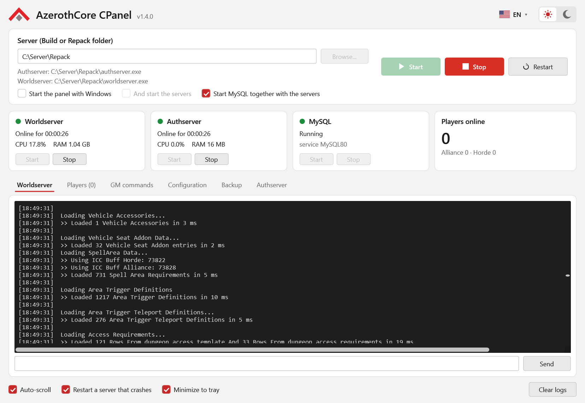
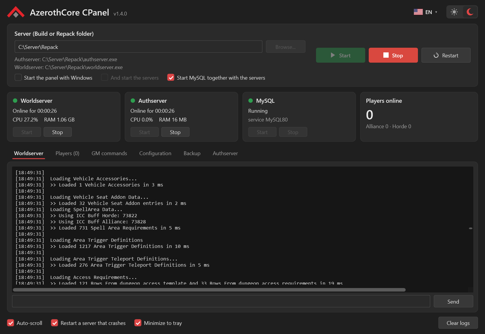
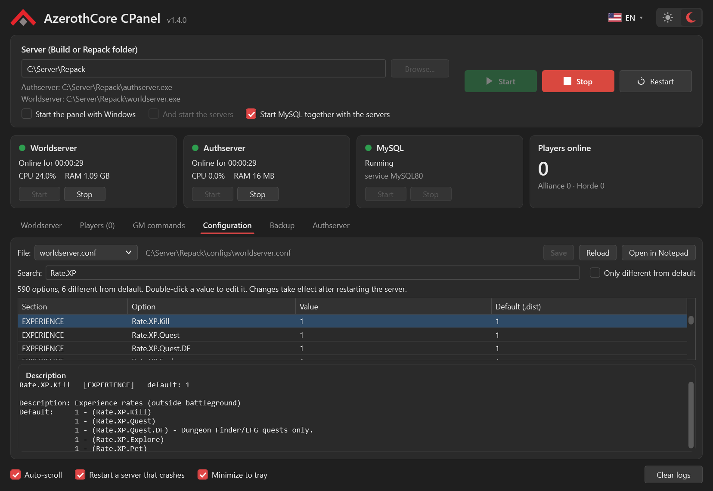

<p align="center"></p>

# AzerothCore CPanel

[English](README.md) · [Português](README.pt-BR.md) · **Español**

Panel de control para Windows hecho para servidores [AzerothCore](https://www.azerothcore.org/)
(World of Warcraft 3.3.5a). En lugar de abrir `authserver.exe` y `worldserver.exe` a mano, el panel se
encarga de todo con un clic.

> **Estado:** versión 1.4 disponible.



| Tema oscuro | Editor de configuración |
| --- | --- |
|  |  |

> Las capturas muestran el panel en inglés, el idioma por defecto. Para usarlo en español, haz clic en la bandera de la
> esquina superior derecha.

## Descarga

Descarga `AzerothCorePanel.exe` desde la [página de releases](https://github.com/EricksOliveira/AzerothCore-CPanel/releases/latest).
Es un único archivo y no necesita instalar .NET.

1. Abre `AzerothCorePanel.exe`
2. El panel se abre en inglés: haz clic en la bandera de la esquina superior derecha y elige **ES — Español**
3. Haz clic en **Examinar...** y elige la carpeta de la Build o del Repack
4. Haz clic en **Iniciar**

## Funciones

- [x] Elegir la carpeta de la Build o del Repack; el panel encuentra `authserver.exe` y `worldserver.exe`
- [x] **Iniciar**: inicia el authserver y luego el worldserver
- [x] **Detener**: apagado limpio (`server shutdown 1`), sin perder datos de los personajes
- [x] **Reiniciar**: detiene e inicia los dos servidores
- [x] Iniciar o detener solo un servidor con los botones **Iniciar** y **Detener** de su fila, en el área de estado
- [x] Logs en vivo de cada servidor, en pestañas, y un campo para enviar comandos a la consola del worldserver
- [x] Reinicia el worldserver solo cuando él lo pide (`server restart`, código de salida 2)
- [x] Si el panel se cierra o se cuelga, los servidores no quedan ejecutándose ocultos (Job Object)
- [x] Reinicio automático tras una caída, con un límite para no quedar en bucle
- [x] Icono en la bandeja del sistema: se minimiza junto al reloj, menú con Iniciar/Detener/Reiniciar y avisos
  cuando un servidor se cae
- [x] Iniciar el panel con Windows (directamente en la bandeja), con opción de iniciar los servidores cuando MySQL
  esté listo
- [x] Uso de CPU y RAM de cada servidor, actualizado cada segundo
- [x] Jugadores en línea: total en el estado y en la bandeja, y una pestaña con nombre, nivel, raza, clase, facción y
  mapa
- [x] Control de MySQL: estado, iniciar y detener (MySQL portátil del Repack o servicio de Windows), e iniciar MySQL
  junto con Iniciar
- [x] Comandos GM por SOAP: pestaña con cuenta GM, atajos, historial, y "Expulsar" en la lista de jugadores
- [x] Copia de seguridad de la base de datos: manual o programada (1h, 6h, 12h, diaria), en .zip, conservando las
  últimas N
- [x] Editor de `worldserver.conf` y `authserver.conf`: tabla con búsqueda, la descripción de cada opción y el valor
  por defecto del `.dist`
- [x] Temas claro y oscuro: botones de sol y luna en la esquina superior derecha, con cambio inmediato
- [x] Tres idiomas: inglés (por defecto), portugués y español, elegidos con el botón de la bandera en la esquina superior derecha

Las ideas y sugerencias son bienvenidas: abre un [issue](https://github.com/EricksOliveira/AzerothCore-CPanel/issues).

## Requisitos

- Windows 10 o superior
- `Console.Enable = 1` en `worldserver.conf` (por defecto). Sin la consola, Detener no puede pedir un apagado limpio
  y termina el proceso a la fuerza tras el tiempo límite.
- Para compilar: [.NET 8 SDK](https://dotnet.microsoft.com/download/dotnet/8.0)

## Cómo funciona

- Cada servidor se inicia con la carpeta de su `.exe` como carpeta de trabajo, para que AzerothCore encuentre la
  carpeta `configs`.
- **Detener** envía `server shutdown 1` al worldserver y espera a que se cierre (60 segundos por defecto). Si no se
  cierra, el proceso se termina a la fuerza. El authserver se termina directamente, porque no guarda datos del juego.
- Los botones **Iniciar**, **Detener** y **Reiniciar** principales actúan sobre los dos servidores. Para iniciar o
  detener solo uno, usa los botones **Iniciar** y **Detener** de su fila (Worldserver o Authserver) en el área de estado.
- **Reiniciar el servidor si se cae** (activado por defecto): si un servidor se cierra sin que nadie lo pida, el
  panel lo inicia de nuevo a los 5 segundos. Tras 3 caídas en 5 minutos desiste, porque el problema probablemente
  es de configuración o de la base de datos. Un `server shutdown` dado en el juego o en la consola no cuenta como
  caída.
- **Bandeja del sistema**: el icono queda junto al reloj mientras el panel está abierto. Haz clic para abrir el
  panel; el clic derecho muestra Iniciar, Detener, Reiniciar y Salir. Con **Minimizar a la bandeja** activado (por
  defecto), al minimizar el panel sale de la barra de tareas. Aparece una notificación cuando un servidor se cae. En
  Windows 11 el icono empieza en el área de iconos ocultos (la flecha ^ junto al reloj); arrástralo a la barra para
  dejarlo siempre visible.
- **Iniciar con Windows**: con **Iniciar el panel con Windows** activado, el panel se abre solo al iniciar sesión,
  directamente en la bandeja. Con **Y iniciar los servidores**, espera a que MySQL acepte conexiones (hasta 3
  minutos, leyendo la dirección de `LoginDatabaseInfo` en `worldserver.conf`) e inicia los servidores. Usa la clave
  `Run` del registro de tu usuario, sin permisos de administrador.
- **CPU y RAM**: junto al estado de cada servidor. La CPU suma todos los núcleos (100% = todos ocupados, como en el
  Administrador de tareas). La RAM es la memoria física en uso (working set); pasa el ratón para ver el pico.
- **Jugadores en línea**: mientras el worldserver está en línea, el panel consulta la base de personajes cada 15
  segundos (usando `CharacterDatabaseInfo` de `worldserver.conf`). El total aparece en el estado y en la bandeja, y
  la pestaña **Jugadores** muestra la lista.
- **MySQL**: el panel busca un `mysqld.exe` dentro de la carpeta del servidor (MySQL portátil, común en Repacks) y,
  si no lo encuentra, un servicio de Windows de MySQL o MariaDB. La fila **MySQL** del estado muestra su estado y
  tiene los botones **Iniciar** y **Detener** (Detener solo se activa con los servidores detenidos). Con **Iniciar
  MySQL junto con los servidores** (por defecto), Iniciar arranca MySQL primero si está detenido. Detener no apaga
  MySQL.
  - MySQL portátil: se inicia con el `my.ini` de su carpeta y se apaga con `SHUTDOWN`, usando la cuenta de
    `LoginDatabaseInfo`. Sigue ejecutándose si el panel se cierra, para no cortarlo en medio de una escritura.
  - Servicio de Windows: iniciar y detener servicios necesita permisos de administrador; si el panel no se ejecuta
    como administrador, Windows pide permiso (UAC).
- **Comandos GM (SOAP)**: la pestaña **Comandos GM** ejecuta comandos por el servicio SOAP del worldserver y muestra
  la respuesta de cada uno. Funciona también con el worldserver iniciado fuera del panel. Necesita
  `SOAP.Enabled = 1` en `worldserver.conf` (el botón **Activar SOAP en worldserver.conf** cambia solo esa línea;
  reinicia el worldserver después) y una cuenta del juego con nivel GM 3. La contraseña se guarda cifrada para tu
  usuario de Windows (DPAPI). Hay atajos (info del servidor, guardar personajes, anunciar, expulsar, crear cuenta,
  dar GM, recargar config), historial con las flechas y, en la pestaña **Jugadores**, el clic derecho expulsa a un
  jugador.
- **Backup**: la pestaña **Backup** usa `mysqldump` (encontrado junto a MySQL) para guardar las bases elegidas
  (cuentas y personajes por defecto; world es grande y se puede recrear) en un `backup_AAAA-MM-DD_HH-MM-SS.zip` con
  un `.sql` por base. Puede ser manual o automático (cada 1, 6 o 12 horas, o una vez al día), y el panel borra los
  backups más antiguos que los N últimos. La carpeta por defecto es `Backups` dentro de la carpeta del servidor.
  Funciona con los servidores en ejecución (`--single-transaction`). Para restaurar:
  `mysql -u root -p acore_char < acore_char.sql`.
- **Configuración**: la pestaña **Configuración** edita `worldserver.conf` y `authserver.conf` en una tabla (sección,
  opción, valor y valor por defecto del `.conf.dist`), con búsqueda en nombre, valor y descripción, y la descripción
  completa de la opción seleccionada. **Solo distintas del valor por defecto** muestra lo que se cambió. Las opciones
  que existen en el `.dist` pero faltan en el archivo (común tras actualizar el core) se muestran en gris y se
  agregan al final al cambiar su valor. Guardar reemplaza solo las líneas editadas, conservando comentarios y
  espaciado, y guarda la versión anterior como `.conf.bak`. Si el `.conf` no existe, **Crear a partir del .dist**
  copia el valor por defecto.
- **Tema**: los botones de sol (claro) y luna (oscuro) en la esquina superior derecha cambian el tema al instante, sin
  reiniciar, incluida la barra de título y el menú de la bandeja. Hasta que elijas uno, el panel sigue el modo de
  aplicación de Windows.
- **Idioma**: el botón con la bandera en la esquina superior derecha abre un menú con inglés (por defecto), portugués y
  español. Todo el panel cambia al instante, incluidas las notificaciones, el menú de la bandeja y el formato de
  números y fechas.
- Solo se ejecuta un panel a la vez: abrirlo de nuevo muestra el que ya está abierto (o en la bandeja).
- La configuración se guarda en `%APPDATA%\AzerothCorePanel\settings.json`.

## Compilar

```powershell
dotnet build src/AzerothCorePanel
```

Para generar un único `.exe` que funciona sin instalar .NET:

```powershell
dotnet publish src/AzerothCorePanel -c Release -r win-x64 --self-contained -p:PublishSingleFile=true `
  -p:IncludeNativeLibrariesForSelfExtract=true -p:EnableCompressionInSingleFile=true
```

## Dependencias

- [MySqlConnector](https://mysqlconnector.net/) (MIT), para consultar la base de personajes.

## Licencia

[MIT](LICENSE)
